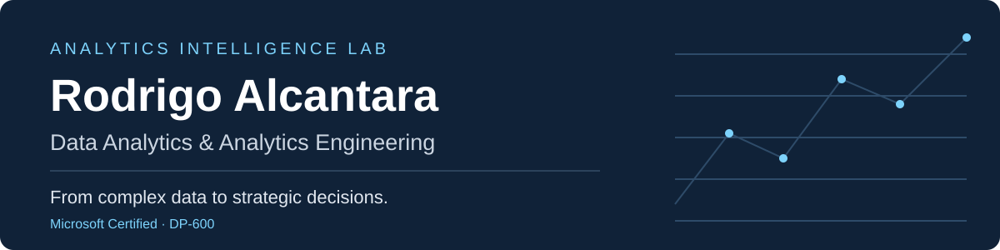

**English** | [Português (Brasil)](README.pt-BR.md)

## About me

Data analytics professional with experience in business intelligence, analytical modeling, data quality and process automation. My work connects business questions with reliable data, reproducible methods and actionable insights.

**Microsoft Certified: Fabric Analytics Engineer Associate (DP-600)**

## Areas of expertise

| Domain | Focus |
| --- | --- |
| Business analytics | KPI design, operational performance, decision support |
| Data quality | Reconciliation, integrity checks, business rules |
| Analytical modeling | Longitudinal journeys, retention, dimensional models |
| Automation | Repeatable analytical workflows and evidence generation |

## Technology stack

**Languages:** SQL · Python · R

**Analytics & BI:** Power BI · DAX · Power Query · Pandas

**Data platforms:** Microsoft Fabric · Databricks · Amazon Redshift

**Portfolio tools:** Streamlit · DuckDB · Pytest · GitHub Actions

## Analytics Intelligence Lab — Live demos

Explore the interactive products below.

| Product | Demonstration | Technical repository |
| --- | --- | --- |
| Data Reconciliation Engine | [Launch data quality audit](https://dgalkan-data-quality.streamlit.app) | [Source](https://github.com/DgAlkan/data-reconciliation-engine) |
| Decision Intelligence Platform | [Launch operational analytics](https://dgalkan-decision-intelligence.streamlit.app) | [Source](https://github.com/DgAlkan/decision-intelligence-plataform) |
| Customer Journey Intelligence | [Launch lifecycle analytics](https://dgalkan-customer-journey.streamlit.app) | [Source](https://github.com/DgAlkan/customer-journey-intelligence) |

## Professional development

Exploring modern data architecture, scalable analytical workflows, decision intelligence and applied AI.

## Professional principles

- Define the business question before choosing the technology.
- Make data quality and analytical assumptions explicit.
- Build reproducible solutions with documented limitations.
- Protect confidential information and use synthetic data in public demonstrations.

---

*Transforming data into intelligence. Intelligence into decisions.*
