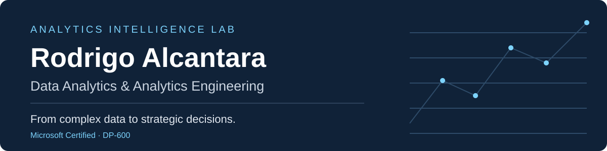

[English](README.md) | **Português (Brasil)**

## Sobre mim

Profissional de análise de dados com experiência em business intelligence, modelagem analítica, qualidade de dados e automação de processos. Meu trabalho conecta questões de negócio a dados confiáveis, métodos reproduzíveis e insights que orientam decisões.

**Microsoft Certified: Fabric Analytics Engineer Associate (DP-600)**

## Áreas de atuação

| Domínio | Foco |
| --- | --- |
| Análise de negócios | Definição de KPIs, desempenho operacional e apoio à decisão |
| Qualidade de dados | Conciliação, verificações de integridade e regras de negócio |
| Modelagem analítica | Jornadas longitudinais, retenção e modelos dimensionais |
| Automação | Fluxos analíticos reproduzíveis e geração de evidências |

## Tecnologias

**Linguagens:** SQL · Python · R

**Analytics e BI:** Power BI · DAX · Power Query · Pandas

**Plataformas de dados:** Microsoft Fabric · Databricks · Amazon Redshift

**Ferramentas do portfólio:** Streamlit · DuckDB · Pytest · GitHub Actions

## Analytics Intelligence Lab — Demonstrações interativas

Projetos independentes de portfólio desenvolvidos com auxílio de IA e dados sintéticos. Explore os produtos interativos abaixo.

| Produto | Demonstração | Repositório técnico |
| --- | --- | --- |
| Data Reconciliation Engine | [Explorar auditoria de qualidade de dados](https://dgalkan-data-quality.streamlit.app) | [Código-fonte](https://github.com/DgAlkan/data-reconciliation-engine) |
| Decision Intelligence Platform | [Explorar análise operacional](https://dgalkan-decision-intelligence.streamlit.app) | [Código-fonte](https://github.com/DgAlkan/decision-intelligence-plataform) |
| Customer Journey Intelligence | [Explorar análise do ciclo de vida](https://dgalkan-customer-journey.streamlit.app) | [Código-fonte](https://github.com/DgAlkan/customer-journey-intelligence) |

A aprovação dos testes de integração contínua (CI) da versão 1.1 foi confirmada por capturas de tela fornecidas pelo responsável pelos projetos. A versão 2.2 acrescenta navegação integrada entre produtos e explicações metodológicas; a execução mais recente dos testes e o acesso anônimo ainda precisam ser verificados. Os repositórios podem exigir autorização. Nunca envie dados confidenciais.

## Desenvolvimento profissional

Explorando arquiteturas modernas de dados, fluxos analíticos escaláveis, inteligência de decisão e IA aplicada.

## Princípios profissionais

- Definir a questão de negócio antes de escolher a tecnologia.
- Explicitar a qualidade dos dados e as premissas analíticas.
- Construir soluções reproduzíveis com limitações documentadas.
- Proteger informações confidenciais e utilizar dados sintéticos em demonstrações públicas.

---

*Transformando dados em inteligência. Inteligência em decisões.*
